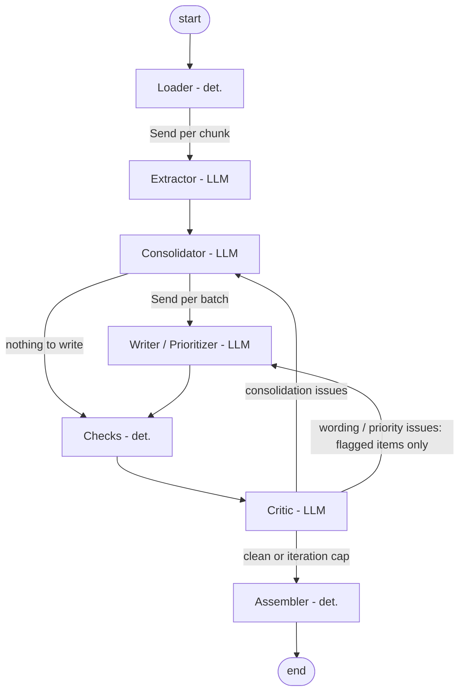

# Design Report: Agentic Requirements-Refinement Network

## 1. Overview

The network turns a directory of heterogeneous texts about a software product into ONE
structured requirements document (`requirements.md` + `requirements.json`). It is built in
LangGraph and uses four LLM nodes on three OpenAI models plus three deterministic
nodes. The pipeline extracts atomic candidates from every document, consolidates them
into a de-duplicated, conflict-free set with a glossary and a blacklist, writes each
requirement (name, paragraph, priority), and then validates the result in a feedback
loop (deterministic checks + an LLM critic) that routes problems back to the node
responsible for them.

The design went through one simplification. A first version had 11 nodes (per-topic
fan-out for deduplication and conflict resolution, a per-chunk completeness auditor, 3
rework loops). It worked on the small corpus but was slow and expensive on the example
corpus, so it was replaced by the current 7-node graph that covers the same specs.

## 2. Graph and nodes

| Node | Type | Model | Responsibility |
|---|---|---|---|
| Loader | deterministic | none | Recursively loads `.txt .md .eml .pdf .docx .html`, assigns `DOC-01…` in sorted path order, reads email dates, chunks long texts (12k chars, 800 overlap) at paragraph boundaries |
| Extractor | LLM, fan-out per chunk | gpt-5-mini | Extracts every candidate need (statement, kind, verbatim quote, priority cues, document date); no judging or merging. A deterministic quote check marks candidates whose quote is not in the source as *ungrounded* |
| Consolidator | LLM | gpt-5.6-luna | Assigns `C-…` IDs; one call builds the scope summary, the glossary and the list of areas; then incremental batches of 80 candidates are each decided as *new / merge / supersede / discard* against the requirements accepted so far. On rework it applies the critic's repairs (merge / discard / edit) and processes candidates still unaccounted for |
| Writer / Prioritizer | LLM, fan-out per batch of 20 | gpt-5-mini (low reasoning effort) | Name, one-paragraph description in glossary terms, type, MoSCoW priority with rationale |
| Checks | deterministic | none | Unique IDs, non-empty name, paragraph-length description, valid priority + rationale, ≥1 source, every candidate accounted for, glossary-synonym usage |
| Critic | LLM | gpt-6-luna | Independent review (model different from the writer): duplicates, conflicts, scope, vocabulary, clarity, priority. Also takes the routing decision |
| Assembler | deterministic | none | Final IDs `REQ-001…`, `DIS-001…`, renders md/json, writes `run_log.json` |

## 3. State and data flow

The state (`network/state.py`) is a `TypedDict`:

- `documents`, `chunks`: loader output (the DOC-ID → file mapping).
- `raw_candidates` (list with an `operator.add` reducer, the fan-in from the parallel
  extractors) → `candidates`: `C-ID → Candidate` with doc ID, date, quote, cues and a
  grounded flag.
- `scope_summary`, `glossary`, `areas`, `reqs`: consolidated requirements with
  `merged_from` (candidate IDs) and `doc_ids`. `discarded` is the blacklist.
- `written`: `signature → Req` (dict reducer, `None` deletes). The signature is
  statement + member candidates, so a requirement whose content did not change keeps its
  written form across loops and is not rewritten.
- `issues`, `rounds`, `loops`, `next`, `unresolved`, `consolidator_feedback`,
  `writer_feedback`: the feedback loop's state.
- `log`: every LLM call (node, model, tokens, time, success) and node event.

Traceability is carried by the data: chunk → candidate (`doc_id`) → requirement
(`merged_from`, union of `doc_ids`) → final `REQ` with *Sources* and *Candidates*.

All LLM outputs are Pydantic schemas parsed with strict JSON-schema structured output
(`network/schemas.py`); no free-text parsing.

## 4. Feedback loop

- **What is checked.** The deterministic checks cover structure, tracing, coverage and
  vocabulary (list above). The critic covers semantic duplicates, conflicts,
  out-of-scope or nonsensical items, inconsistent vocabulary, unclear text and
  priorities that contradict their rationale.
- **Severity filter.** Only *high* and *medium* critic issues are actionable. *Low*
  issues are listed as minor notes.
- **Routing.**
  - Duplicates, conflicts, scope problems and unaccounted candidates go back to the
    **Consolidator**. It repairs them, after which the changed requirements are
    rewritten.
  - Wording, vocabulary and priority problems go back to the **Writer**, but only for
    the flagged requirements, with the reviewer's note attached.
- **Stop condition.** The loop stops when there are no actionable issues, or when
  `--max-iterations` (default 2) rework loops have been done. At the cap the network
  finishes and lists the remaining issues as *Unresolved warnings* in the document's
  validation summary.

## 5. Model selection

| Node | Model | Why |
|---|---|---|
| Extractor | gpt-5-mini | Highest call volume (one call per chunk); extraction is a reading task a cheap model does well |
| Consolidator | gpt-5.6-luna | Needs a long context (the whole accepted set plus a batch) and careful semantic comparison; mid-tier cost |
| Writer | gpt-5-mini, low reasoning effort | Many batches of plain rewording |
| Critic | gpt-6-luna | Strongest model for the whole-document review, and deliberately a different model than the writer to avoid self-confirmation |

All seven available models were checked with `check_models.py` and all support
structured outputs, so any of them can be swapped in `network/config.py`.

## 6. Coverage of the specs

| Spec | Addressed by |
|---|---|
| ANS1 ≥3 LLM nodes | Extractor, Consolidator, Writer, Critic |
| ANS2 ≥1 deterministic node | Loader, Checks, Assembler |
| ANS3 feedback loop | Checks + Critic → Consolidator / Writer, capped |
| ANS4 ≥3 models | gpt-5-mini, gpt-5.6-luna, gpt-6-luna |
| ANS5 LangGraph | `StateGraph`, `Send` fan-out, conditional edges, reducers |
| OS1 single structured document | Assembler: one md with fixed sections (+ identical json) |
| OS2 unique IDs | Assembler numbering; Checks verify uniqueness |
| OS3 no duplicates | Consolidator *merge* decisions; Critic *duplicate* issues → repair *merge* |
| OS4 tracing | `doc_ids` and `merged_from` carried from the chunk; Sources + Candidates per requirement; DOC table |
| OS5 name + paragraph | Writer schema fields and prompt; Checks: non-empty name, ≥20-word single paragraph |
| OS6 priority + scale | MoSCoW definitions in config, rendered in the document; Writer priority + rationale from source cues; Checks validate |
| OS7 consistency | Glossary (canonical terms + synonyms to avoid) used by Consolidator and Writer; Checks flag synonyms; Critic checks vocabulary and conflicts; conflict rules (decision > recency > sources > formality) |
| OS8 completeness | Extractor told to extract everything; every candidate must end in a requirement or the blacklist (Checks), unaccounted ones are re-processed |
| OS9 blacklist | Consolidator *discard / supersede* + repair *discard* + ungrounded candidates; original statement, sources, category, explanation, conflicting REQ |

## 7. Generalization measures

- **No corpus specifics.** Code and prompts contain no file names, product, domain
  vocabulary or expected counts. The only few-shot example is an invented greenhouse
  irrigation controller.
- **Generic input handling.** Inputs are discovered recursively by extension, with IDs
  in sorted order. No logic branches on file names, document count or domain.
- **Generic, justified limits.** Chunk size, batch sizes, grounding threshold and
  iteration cap are generic values with a justification in `config.py`.
- **Generic debugging fixes.** Every fix made during debugging is generic:
  - fields of one report are one requirement;
  - the blacklist shows the original wording;
  - synonym filtering (no plurals or parts of a term);
  - a fixed area list;
  - batch consolidation once a single call could not handle 700 candidates.
- **Synthetic smoke test.** `tests/synthetic_corpus/docs/` is a city bike-sharing app:
  meeting notes, an email, a feature wishlist and a survey. `EXPECTED.md` lists the
  planted cases; the output (from a run before the last fixes listed above) is in
  `tests/synthetic_corpus/output/`. Result: both duplicates were merged with combined sources. The
  15-vs-5-minute conflict was first missed by the Consolidator, then caught by the
  Critic and resolved by the loop (5 minutes kept, 15 in the blacklist as a conflict).
  The impossible "teleport" request and the office parking spot were blacklisted, and
  postponed gamification was blacklisted citing the decision. Priorities followed the
  cues (QR unlock and GPS-trace deletion Must; dark mode and reservation Could).

## 8. Results on the example corpus and known limitations

Final run on `data/corpus` (20 documents, 22 chunks), output in `output/`:

| Metric | Value |
|---|---|
| Candidates extracted / grounded | 719 / 719 |
| Requirements | 243 (202 functional, 41 non-functional) in 8 areas |
| Discarded (blacklist) | 36 (29 other, 6 out of scope, 1 conflict) |
| Candidates accounted for | 719 / 719, none assigned twice |
| Documents cited as sources | 20 / 20 |
| Priorities | 38 Must, 203 Should, 2 Could |
| Feedback loop | 3 validation rounds, 2 rework loops (cap); issues per round 144 → 46 → 31 |
| LLM calls | 60 (22 extractor, 12 consolidator, 23 writer, 3 critic), 0 failed |
| Tokens / time | ~318k input, ~292k output, ~17 min |

The loop measurably improved the document: the rework rounds merged duplicate
requirements (262 → 243), moved further items to the blacklist (30 → 36) and rewrote
the flagged descriptions, reducing the actionable issues from 144 to 31.

Known limitations (reported honestly in the document's validation summary):

- **31 issues remain unresolved at the cap.** 23 are vocabulary warnings (e.g. "staff
  user" instead of "Staff member", "OPAC" instead of the full term) and 8 are critic
  findings (4 near-duplicate pairs, 2 unclear descriptions, 1 scope and 1 priority
  question). More loops would reduce them at extra cost; the cap is a deliberate trade-off.
- **Priorities skew to Should**, because many sources use neutral wording and the
  writer is told not to raise a priority without a cue.
- **Few conflicts were detected.** The corpus contains few hard contradictions, and
  the consolidator tends to merge or supersede rather than discard.
- **Granularity is model-dependent.** Formal specifications yield many fine-grained
  candidates; batch consolidation keeps this tractable but sequential, which makes it
  the slowest step.
- **The quote check is lexical**: it detects invented quotes, not misread meaning.
- **Glossary synonyms come from the LLM** and may include debatable entries; the
  deterministic filter removes inflections and fragments of terms, the critic judges
  the rest.

## 9. Final checklist

| Item | Status | Note |
|---|---|---|
| ANS1 ≥3 LLM nodes | ✅ | Extractor, Consolidator, Writer, Critic |
| ANS2 ≥1 deterministic node | ✅ | Loader, Checks, Assembler |
| ANS3 feedback loop | ✅ | Checks + Critic → Consolidator / Writer, cap 2, used in both test runs |
| ANS4 ≥3 models | ✅ | gpt-5-mini, gpt-5.6-luna, gpt-6-luna |
| ANS5 LangGraph | ✅ | StateGraph, Send fan-out, conditional edges |
| OS1 single document | ✅ | `output/requirements.md` (+ json) |
| OS2 unique IDs | ✅ | REQ-001…REQ-243, DIS-001…DIS-036 |
| OS3 no duplicates | ⚠️ | Most merged; 4 near-duplicate pairs left as unresolved warnings |
| OS4 tracing | ✅ | Sources + candidate IDs on every requirement |
| OS5 name + paragraph | ✅ | All 243 have both |
| OS6 priority + scale | ✅ | MoSCoW, defined in section 3 of the document |
| OS7 consistency | ⚠️ | Glossary enforced; 23 vocabulary warnings remain |
| OS8 completeness | ✅ | 719/719 candidates accounted for |
| OS9 blacklist | ✅ | 36 entries with category and reason |
| Code | ✅ | `main.py`, `network/` |
| DESIGN_REPORT.md | ✅ | this file |
| Requirements document | ✅ | `output/requirements.md`, unedited network output |
| Synthetic smoke test | ✅ | `tests/synthetic_corpus/` (docs, EXPECTED.md, output) |

## 10. How to run

See [README.md](README.md):
`python main.py --input-dir data/corpus --output-dir output`.
